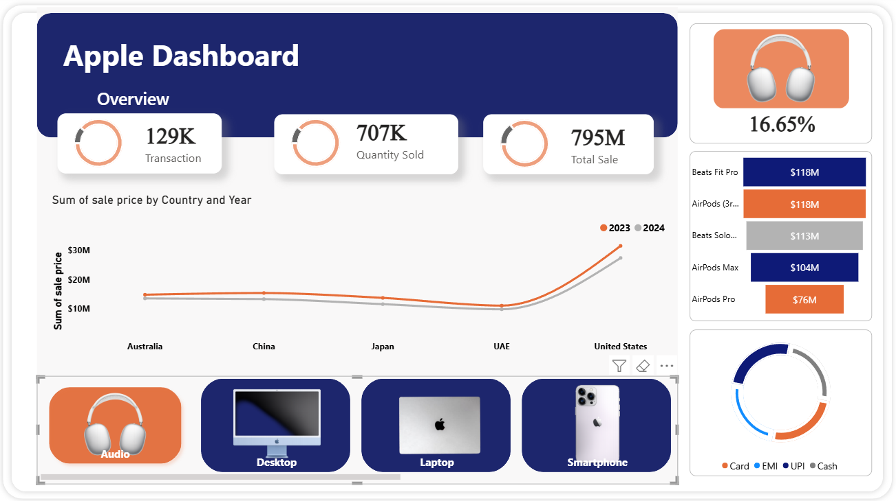

# Apple-Company-Dashboard

**Apple product sale Analytics:** \
Product Sales insights Dashboard
A dynamic, interactive data visualization tool built to explore sales on country, product wise, category wise and payment methods.

The Apple product Dashboard is a visually engaging and analytical Power BI report designed to help and compare over product category across most selling countries.
The dashboard provides information about Total Transactions, Quantity Sold, Total Sales, Sales by Country, Sales by Year, Top Products, Payment Mode, Product Categories. Also used category images as a slicer to make the dashboard more interactive and attractive.

The dashboard was built using the following tools and technologies:
* 📊 Power BI Desktop - Main data visualization platform used for report creation.
* 📂 Power Query - Data transformation and cleaning layer for reshaping and preparing the data.
* 🧠 DAX (Data Analysis Expressions) - Used for calculated measures, dynamic visuals, and conditional logic.
* 📝 Data Modeling - Relationship established among tables (category, sales, products and stores) to enable cross-filtering and aggregation.
* 📁 File Format - .pbix for development and .png for product images.

Data on 1M+ rows of sales record around the world and other complementary tables of products, category and stores.

Business problems:\
Which products are performing better, sales performance for different years and countries, payment methods and total renenue.

The main areas of analysis were: \
*Sales Analysis:* I analysed the total sales generated by the products. \
*Quantity Analysis:* I analysed the total number of products sold. \
*Transaction Analysis:* I calculated the total number of transactions. \
*Country Analysis:* I compared sales between different countries. \
*Year Analysis:* I compared sales between 2023 and 2024.\
*Product Analysis:* I identified products that generated higher sales. \
*Payment Analysis:* I analysed payment methods such as EMI, Cash, Card and UPI.

Dashboard Design\
The dashboard contains several important visuals.\
A) KPI Cards\
These provide a quick overview of the business performance. Three main KPI cards are displayed:\
• Transactions\ 
• Quantity Sold\
• Total Sales\
B) Line Chart\
The line chart shows:\
Sum of Sales Price by Country and Year. It allows comparison between 2023 and 2024.\ 
C) Bar Chart\
The bar chart shows the sales of different products of category and helps identify high-performing products.\
D) Donut Chart\ 
The donut chart displays the distribution of different payment methods.\
E) Product Category Slicer\
The bottom section contains images for categories.\ 
9. Product Category Image Slicer\ 
One of the main features of my dashboard is the category image slicer which make it more attractive and better for business decisions.\ 
Instead of using a normal text slicer, I used category images.\
For example: Audio | Desktop | Laptop | Smartphone\ 

From the dashboard, Business insights are the following: \
• The United States has the highest sales among the countries displayed. \
• Canada has comparatively lower sales in the displayed view. \
• The dashboard allows comparison between 2023 and 2024. \
• Tablet sells the most among all categories. \
• Some products contribute significantly more sales than others. \
• Customers use different payment methods.

Screenshot of Dashboard: 

